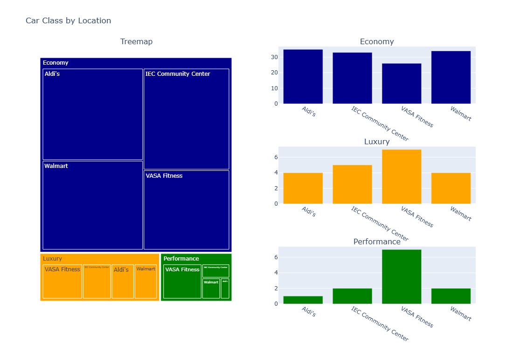
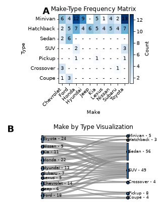
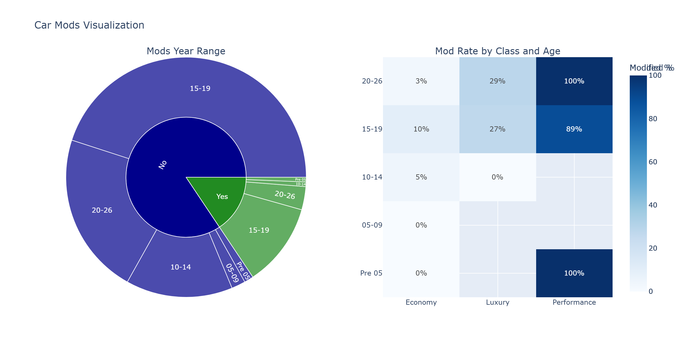
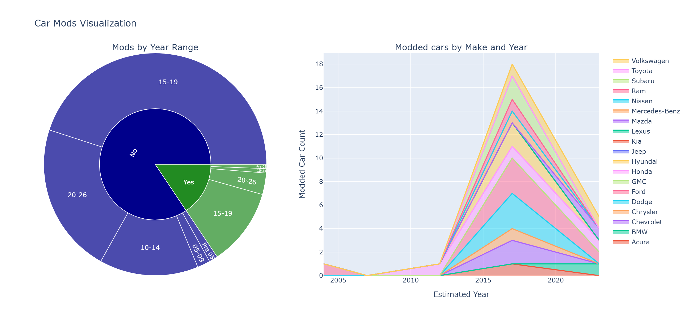
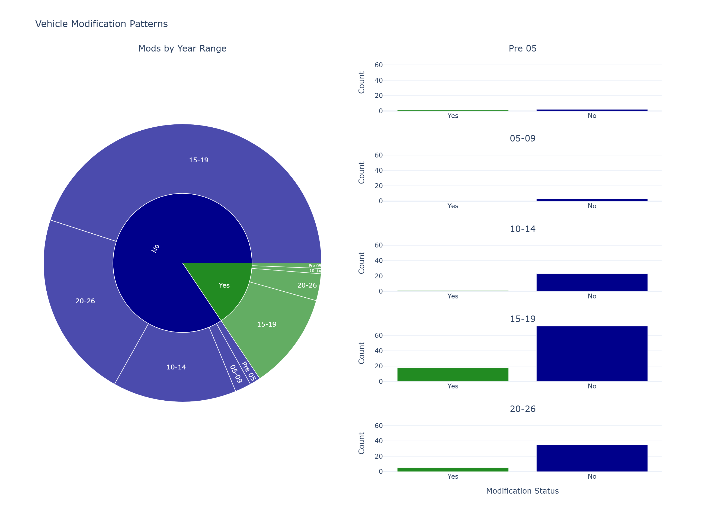

# CS-424-Assignment-2-AuonNaqvi

## Task 1
Here are the domain questions from Assignment 1, with the related data questions.

Domain Questions:
- How does the age distribution of cars differ across locations?
- Which Makes(brands) are more associated with particular car types?
- Are modified cars concentrated within certain year ranges, classes, or locations?
- How does the distribution of car class vary across locations?

Data Questions:
- What is the car year-range distribution at each of the four locations?
- What is the frequency of each car type within each car make (brand)?
- What is the distribution of modded cars, by year range, car class, or location?
- What is the distribution of Economy, Luxury, and Performance cars across all 4 locations?

In assignment 1 I had already performed basic clean-up of the dataset. This meant running it through spellchecks, missing value checks, and making sure all entrees had consistent attribute types (int or string, mainly). When it comes to uncertainty I had already clarified in Assignment 1 the difficulties inherently present with my data collection method, particularly when it came to year and type approximations. As it pertains to the year range, in order to make the data more compatible with different kinds of graphs and charts I'm considering turning the different year-ranges into their average year (except pre 05 cars, which I'll just label as 2004.) I'm wondering about the practicalities of this decision though, as within the year-range approximations there could be the chance of, say, 80% of cars in the 05-09 category are 08 or 09. This would make the average (07), a bad representation of this group of cars. For car types, I believe my tendency to identify more SUV-crossovers is actually consistent with the industry. The majority of crossovers are from 15-19. Since American car design philosphy started changing around 2018-2019, the latter end of the year-range group, I'd be far less likely to misclassify a hatchback as an SUV crossover. Pre-2018, the design approaches for these two car types was quite distinct.

In my opinion, my domain questions were answerable from the dataset and also provided very unique insights in regards to it. For that reason I'm going to go through Assignment 2 with the above domain questions. Any changes will be documented in later tasks.

## Task 2
In the new dataset, I decided to add observation IDs for each car, in case I chose to speak about specific observations. I also added Year Start, Year End, and a midpoint in order to make it easier to create something like a time-series and/or make it easier to encode the year-range attributes in terms a temporal manner rather than a categorical manner. Is Modified is either 0 or 1, making it easier to obtain frequencies for certain graph types. For "Pre-05" I decided to set the year start and end to 2004, and therefore the average is also 2004. This is for greater graph and chart variety and I consider it a worthy trade-off for greater visualization flexibility.

For clarification, Cars_Alt is simply me manually undoing Excel's screw-up in regards to 10-14. It turned 10-14 into October 14 when obviously in context it means 2010-2014. The Task2 notebook uses Cars_Alt for simplicity's sake.
- [Cleaned Dataset](CarsCleaned.csv)
- [Task 2 Jupyter Notebook](Task2.ipynb)

## Task 3

In my EDA, I started with .describe to get a bird's eye view of all the data. It lists the top counts for each attribute. I wasnt surprised when I saw that the most common model was the Honda Civic, nor that the top make was Toyota. I had already assumed this much before aggregation. I was initially surprised to see the most popular car type is actually a Sedan, but when the more I thought about it, the more sense it made. Toyota and Honda were the top two makes, among them, and over half their cars were sedans. Additionally, 8/19 manufacturers had atleast 50% of their cars be Sedans. My assumption was that the most popular type would be SUVs, considering how America at large has a car culture that's essentially "bigger is better", but just because this is a mainstream belief doesn't mean everyone has the resources to act on it.

I also explored car colors across different body types, which was not one of my original domain questions. However this did allow me to investigate whether relationships existed outside the attributes I had initially prioritized. Car types with very few observations made some proportional comparisons difficult to interpret, but from the EDA, Nearly half of all black cars were Sedans, while nearly half of all silver and white cars were SUVs.

When exploring modifications, I initially visualized all modification categories together, but, as unmodified cars made up the majority of the dataset, the other categories were comparatively difficult to distinguish. Filtering the data to show only modified cars, I made the distribution of actual modification types easier to examine. This is actually a great example of how changing the scope of an analysis reveal details hidden by aggregation. While the conclusion was obvious (Almost 100% of performance cars were modded, conversely around 50% of all modded cars were performance cars).

Given this EDA, I'm considering creating a visualization for color. The problem is I'm not sure how much insight this would actually yield, and this is mainly due to the nature of paints/colors in the car industry. Standardizing paints and colors has traditionally been one of the easiest ways for any business (selling at scale) to cut down on expenses. Higher custimization inherently means higher cost. I'll consider creating a visualization for car colors, but it's really up in the air as to whether anything interesting and reliable will come out of it.

## Tasks 4 and 5 

Task 4:
For each direction, briefly discuss:

What question or task it supports. How does the distribution of car class vary across locations?

Which data attributes it uses. Location, Class, and the frequency of each class-location combination.

The treemap uses nested rectangles, with area representing the frequency of observations and color distinguishing the three car classes. Grouping identifies locations within each class. The three bar charts use position on a common scale to encode car counts with a separate chart for each class. This was based on my original treemap sketch from Assignment 1, but I wanted to address one of its biggest weaknesses, which is also counterintuitively what made me choose it in the first place; comparing areas is significantly less precise than comparing lengths along a common baseline. The treemap is useful for immediately showing a few things. First, that Economy cars are most of the dataset and that the Vasa has the highest count of performance cars, but differences within the smaller Luxury and performance categories are harder to see and within the economy class it's hard to tell which location had the highest count. I said walmart and when I showed my mom she said IEC. I therefore included three separate bar charts, allowing viewers to compare location frequencies more precisely within each car class. For example, on the graph, once can clearly see that Walmart has more economy cars than IEC. The two views serve different purposes. The treemap emphasizes the overall composition of the dataset and lets you see big differences in counts immediately, while the bar charts provide more precise comparisons.
    
Task 5:
I decided that interaction would contribute relatively little to this visualization. There are only four locations and three car classes, meaning twelve possible class location combinations. All twelve combinations are already visible without filtering, scrolling, or navigation. Filtering by class would essentially reproduce one of the three bar charts already present, making that interaction redundant. also details on demand would offer almost no benefit because the values of the bar chart are small counts that can already be interpreted using the bar-chart axes already. Zooming would also be unnecessary because the visualization does not contain enough categories to require it. The multiple views already accomplish what an interactive selection would give. Viewers can use the treemap for an overview and immediately compare a class using its corresponding bar chart. Although the representation is somewhat redundant, that's the point. The bar chart acts as a zoom because of it's increase in detail.

    
    

Task 4:
For each direction, briefly discuss:

What question or task it supports. Which makes (brands) are more associated with particular car types?

Which data attributes it uses. Make, Type, and count of each make type combination.

the frequency matrix uses rectangular cells arranged by car make and type. Color intensity represents the number of observations, and darker cells indicate higher frequencies. The Sankey diagram uses nodes to represent makes and types, while connecting bands encode the frequency of their relationships throughthe width.
For this second visualization, I experimented with a frequency matrix and a Sankey diagram. The matrix was adapted from my original Assignment 1 sketch, though I decided to replace the square sizes with color intensity to make the grid more consistent and because when testing, color felt easier to distinguish than color. The Sankey diagram was an entirely new graph that I explored because I wanted to represent the relationships between car manufacturers and body types in a less conventional way. Kinda been my whole aim and also what I feel like the assignments are pushing us towards, which I'm happy to indulge. The matrix is effective for identifying specific combinations, such as which manufacturers have the highest Sedan or SUV counts, whereas the Sankey diagram presents the same relationships as "flows", letting you follow how observations from individual manufacturers are distributed among car types. In this way, the matrix shows the individual frequencies of make by model, while the Sankey diagram emphasizes connections and distribution. One major limitation for the sankey was the number of manufacturers. My original dataset contained nineteen makes, which made the labels and connections difficult to read, so I limited this visualization to the ten most frequently observed makes. This improved readability, at the cost of it removing less common manufacturers from this particular analysis, which is fine with me, as my focus was always directed towards the top manufacturers anyway..The Sankey also remained somewhat crowded because several manufacturers connect to multiple car types.

Task 5:
I chose not to implement interaction because I had already reduced the scope to ten makes and seven possible body types. This creates a relatively manageable number of relationships, all of which can be examined within the two static views. The matrix directly shows the make type combination counts while the Sankey visually connects the same categories. Maybe a interactive selection that highlights a manufacturer's relationships could be helpful, but it would mostly emphasize information already visible in the Sankey, just more of it, which I think is unnecessary. As was stated above, the implied focus was on the more frequent makes. Detail on demand is also less necessary here because the matrix includes numerical counts within its cells and the Sankey displays the categories and their overall connections. The two views effectively provide alternative ways to inspect the same relationships without requiring the viewer to navigate between states, an arguably superior approach.

Task 4:
For each direction, briefly discuss:

What question or task it supports. Are modified cars concentrated within certain year ranges, classes, or locations?

Which data attributes it uses. Modified, Year_Range, Class, Is Modified, and the modification percentage for each year range estimate and class combination.

The sunburst uses arc segments, with angle and arc length representing observation counts. The inner ring us for modified and unmodified cars, while the outer ring represents the approximate year ranges across both modification states. Color distinguishes modification status.
    
The matrix uses rectangular cells positioned by car class and year range, with hue intensity representing modification percentages and percentages are displayed within the cells for a reason I will shortly address. For my third visualization, I combined a sunburst diagram with a mod rate matrix. The sunburst was adapted from my Assignment 1 sketch, while the matrix was introduced to overcome a weakness I noticed in assignment 1, that being that the sunburst immediately communicates that most observed cars were unmodified, and that 2015-2019 contributes a large count of the modified cars. However, I realized that this could be misleading because the dataset contains many more cars in that year range overall. A higher number of modded cars does not necessarily mean that cars in that category have a higher probability of being modified. To address this, I added a matrix displaying the percentage of cars modified within each combination of class and year range. This allows me to examine whether modification rates differ across categories rather than relying exclusively on raw counts. Interestingly enough, we find that despite 15-19 making the bulk of modded cars, when looking at the matrix, 100% of performance cars from 2020-26 are modded as compared to 89% of 15-19 cars. Provided only the sunburst diagram, a viewer could've easily made the wrong assumption that more 2015-19 performance cars were modded than 20-26 cars. A weakness of the matrix is that cells containing only one or two observations can display extreme percentages, such as 100%, even though the evidence supporting those values is limited, however this is somewhat unavoidable considering the fact that there were less than 25 modded cars.

Task 5:

I decided that a static visualization was more appropriate because the sunburst contains only two modification categories and five year ranges, while the matrix compares three car classes across those same five ranges. The total number of possible matrix combinations is only fifteen, which means there aren't a large number of cells, making filtering and navigation unnecessary. An interactive filter for car class or year range would largely just duplicate information already visible in the matrix.  The sunburst's hierarchy is shallow enough that interactivity would provide little additional information in the way of mods vs year range.

## Task 6

Again as said, the most tangible issue with the sunburst is that it doesn't show the frequency of modded/unmodded cars proportional to each year. However instead of fixing this, I ended up adding extra information about makes within each year, the problem with the streamgraph is that it doesn't fix the fundemental issue, so I scrapped it.

This was my second Visualization for the Modification visualization. I tried to add bar charts to fix the problem stated above with sunburst, the issue of not showing proportions by year properly, However not only did I find this aesthetically unpleasing, Years with low counts have a thin green line, which is an artifact of the scale showing both Yes and No mods, which it needs to do.  sdgdghjg

Eventually, I realized that I didn't necessarily have to elaborate on the flaw of the sunburst; rather, I could give more relevant information to supplement its findings. By creating the matrix, viewers can compare year to modifications *as well as* more intricate details regarding the proportion of modded cars via both class and year. While it doesn't fix the sunburst's issue outright, it does provide an insight that prevents bad assumptions that could be taken from viewing the sunburst as a singular entity.

## Task 7

For Assignment 3, I've decided to continue with my Car Mods Visualization. This visualization primarily addresses my third domain question; Are modified cars concentrated within certain year ranges, classes, or locations? More specifically, the current design focuses on year ranges and vehicle classes rather than locations.

The main reasons I chose this direction was twofold. First, because the two graphs complement each other in a way that I think is quite unique. As stated above, the matrix does not completely fix the sunburst's flaw, yet it still prevents specific potentially untrue assumptions from being made. Particularly when it pertains to Modification distribution across car classes and year. As stated many times, the sunburst's arcs make immediate observations obvious; A majority of cars are unmodified, and a majority of modified cars are from 15-19. 

I think the strongest aspect of the current design is that it allows viewers to distinguish between the number of modified vehicles and the proportion modified within a given group. For example, the 2015–2019 category contains many modified vehicles, but the matrix reveals that modification rates also vary considerably by vehicle class. The Performance category shows particularly high modification rates from 2020-2026, which would be less obvious from the sunburst alone.

There are still a few things I'm unsure about. Some matrix cells show very high percentages, including 100%, but these can and, due to the limited nature of a small affirmative dataset, mostly likely will be, skewed heavily because of smaller confirmed modded cars. I'm also unsure whether the sunburst's smaller segments are sufficiently readable, particularly for the less common year ranges, though I believe that's an issue of file resolution. Finally, the current visualization doesn't examine modifications by location, even though location is included in my original domain question. To be fair, I became less interested in this statistic after realizing sports cars are more likely to be modded and more sports cars appear in VASA. 

